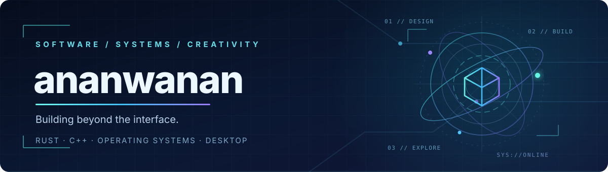

 

  

**Low-level engineering. Thoughtful interfaces. Software built to last.**

---

## 01 / About me

I'm a developer exploring the space between **systems programming**, **native desktop software**, and **interactive graphics**.

- 🦀 **Systems:** Rust, operating systems, toolchains, and application runtimes.
- 🧩 **Desktop:** C++ / Qt and native applications with clean, modular architectures.
- 🪐 **Graphics:** 3D visualization and interactive experiences.
- ⚙️ **Engineering:** Performance, developer tooling, maintainability, and pragmatic automation.

> Currently building an operating system from scratch, a plugin-driven editor, a cross-platform archive manager, and an interactive solar-system wallpaper.

## 02 / Featured projects

<table>
  <tr>
    <td width="50%" valign="top">
      <h3>🪐 <a href="https://github.com/ananwanan/AnovaOS">AnovaOS</a></h3>
      
An experimental <strong>x86_64 operating system built from scratch in Rust</strong>, with native applications, a desktop stack, and selected Linux software compatibility.

      
  

      
<a href="https://github.com/ananwanan/AnovaOS"><strong>Explore repository →</strong></a>

    </td>
    <td width="50%" valign="top">
      <h3>⌨️ <a href="https://github.com/ananwanan/RustEditor">RustEditor</a></h3>
      
A <strong>native Rust text and code editor</strong> inspired by Notepad++, organized as a Cargo workspace with a dynamic-library plugin architecture.

      
  

      
<a href="https://github.com/ananwanan/RustEditor"><strong>Explore repository →</strong></a>

    </td>
  </tr>
  <tr>
    <td width="50%" valign="top">
      <h3>📦 <a href="https://github.com/ananwanan/AnAnArchiver">LiteArc</a> (AnAnArchiver)</h3>
      
A <strong>cross-platform archive manager</strong> built with C++23, Qt 6 Quick/QML, and libarchive, focused on responsive workflows and secure streaming operations.

      
  

      
<a href="https://github.com/ananwanan/AnAnArchiver"><strong>Explore repository →</strong></a>

    </td>
    <td width="50%" valign="top">
      <h3>🌌 <a href="https://github.com/ananwanan/AnAnCelestialWallpaper">AnAnCelestialWallpaper</a></h3>
      
An <strong>interactive solar-system wallpaper</strong> for Wallpaper Engine, using Three.js / WebGL with local orbital calculations and optional satellite visualization.

      
  

      
<a href="https://github.com/ananwanan/AnAnCelestialWallpaper"><strong>Explore repository →</strong></a>

    </td>
  </tr>
</table>

## 03 / Technology

**Systems & tooling** `Rust` `C++23` `CMake` `Linux` `Git`

**Desktop & graphics** `Qt 6 / QML` `Native GUI` `Three.js` `WebGL`

## 04 / GitHub activity

<picture>
  <source media="(prefers-color-scheme: dark)" srcset="https://github-profile-summary-cards.vercel.app/api/cards/profile-details?username=ananwanan&theme=github_dark" />
  
</picture>

 

<picture>
  <source media="(prefers-color-scheme: dark)" srcset="https://github-profile-summary-cards.vercel.app/api/cards/repos-per-language?username=ananwanan&theme=github_dark" />
  
</picture>
<picture>
  <source media="(prefers-color-scheme: dark)" srcset="https://github-profile-summary-cards.vercel.app/api/cards/most-commit-language?username=ananwanan&theme=github_dark" />
  
</picture>

## 05 / Connect

Ideas, collaboration, or a conversation about systems and software engineering?

**Email:** [coder-cc@outlook.com](mailto:coder-cc@outlook.com)  
**GitHub:** [github.com/ananwanan](https://github.com/ananwanan)

DESIGN  ·  BUILD  ·  EXPLORE

